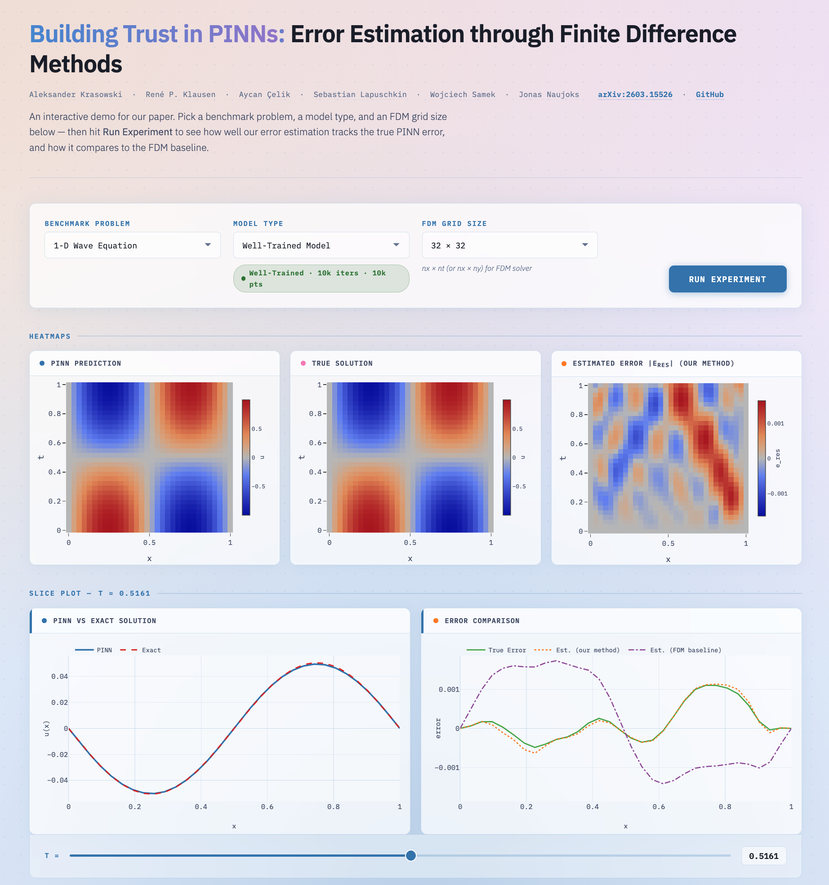

# Building Trust in PINNs: Error Estimation through Finite Difference Methods

Aleksander Krasowski, René Pascal Klausen, Aycan Celik, Sebastian Lapuschkin, Wojciech Samek, Jonas Naujoks

[](https://arxiv.org/abs/2603.15526) [](https://pinn-error.hhi.fraunhofer.de)

This repository accompanies the paper "[Building Trust in PINNs: Error Estimation through Finite Difference Methods](https://arxiv.org/abs/2603.15526)" (late-breaking work at the 4th World Conference on eXplainable Artificial Intelligence, xAI-2026, Fortaleza, Brazil).

We propose a post-hoc method that estimates the pointwise error of physics-informed neural networks by solving the associated error equation via finite difference methods, requiring no knowledge of the true solution.

## Interactive web demo

Check out the error estimation in your browser: [pinn-error.hhi.fraunhofer.de](https://pinn-error.hhi.fraunhofer.de)

[](https://pinn-error.hhi.fraunhofer.de)

## Quickstart

I recommend using [uv](https://docs.astral.sh/uv/) for environment management. From the project root, run

```bash
uv sync
source .venv/bin/activate
```

If you wish to work with Jupyter, use `uv sync --extra jupyter` instead.

Without uv, you can install the package with pip (from the project root):

```bash
pip install .  # or with Jupyter: pip install ".[jupyter]"
```

## Running an example

You can execute individual examples using the experiment runner script

```bash
python examples/run_experiment.py --problem heat --frequency 2 --diffusivity 0.05 --nx 16 --nt 16
```

For accepted arguments please run

```bash
python examples/run_experiment.py --help
```

Currently implemented problems include the following. By default, all are posed on $x \in [0, 1]$ (and $t \in [0, 1]$ or $y \in [0, 1]$), which can be changed via `--x_min`, `--x_max`, `--t_max`, `--y_min` and `--y_max`. The formulas below assume $x_{\mathrm{min}} = 0$ (and $y_{\mathrm{min}} = 0$).

- `heat` (1D heat equation)
  - PDE: $\frac{\partial u}{\partial t} - \alpha \frac{\partial^2 u}{\partial x^2} = 0$
  - IC: $u(x,0) = \sin(n \pi \frac{x}{x_{\mathrm{max}}})$
  - BCs:
    - $u(x_{\mathrm{min}}, t) = 0$ (Dirichlet)
    - $u(x_{\mathrm{max}}, t) = 0$ (Dirichlet)
  - named parameters:
    - `frequency` $n$
    - `diffusivity` $\alpha$
- `wave` (1D wave equation)
  - PDE: $\frac{\partial^2 u}{\partial t^2} - c^2 \frac{\partial^2 u}{\partial x^2} = 0$
  - ICs:
    - $u(x,0)=\sin(n \pi \frac{x}{x_{\mathrm{max}}})$
    - $\frac{\partial u}{\partial t}(x,0) = 0$ (initial velocity)
  - BCs:
    - $u(x_{\mathrm{min}}, t) = 0$ (Dirichlet)
    - $u(x_{\mathrm{max}}, t) = 0$ (Dirichlet)
  - named parameters:
    - `frequency` $n$
    - `propagation_speed` $c$
- `drift_diffusion` (1D convection-diffusion equation)
  - PDE: $\frac{\partial u}{\partial t} - \alpha \frac{\partial^2 u}{\partial x^2} + v \frac{\partial u}{\partial x} = 0$
  - IC: $u(x,0)= A \sin(n \pi \frac{x}{L} + \varphi)$ with $L = x_{\mathrm{max}} - x_{\mathrm{min}}$
  - BCs:
    - $u(x_{\mathrm{min}}, t) = g(x_{\mathrm{min}}, t)$ (Dirichlet)
    - $u(x_{\mathrm{max}}, t) = g(x_{\mathrm{max}}, t)$ (Dirichlet)
  - with exact solution: $g(x,t) = A \sin(\varphi + \frac{n \pi}{L} (x - v t)) \cdot \exp(-\alpha (\frac{n \pi}{L})^2 t)$
  - named parameters:
    - `frequency` $n$
    - `diffusivity` $\alpha$
    - `velocity_x` $v$
    - `initial_concentration` $A$
    - `phase_shift` $\varphi$
- `poisson_1d` (1D Poisson equation - steady)
  - PDE: $- \frac{\partial^2 u}{\partial x^2} - f(x) = 0$
  - with source term: $f(x) = (\frac{\pi}{x_{\mathrm{max}}})^2 \cdot \sin(\pi \frac{x}{x_{\mathrm{max}}})$
  - BCs:
    - $u(x_\mathrm{min})=0$ (Dirichlet)
    - $u(x_\mathrm{max})=0$ (Dirichlet)
- `poisson_2d` (2D Poisson equation - steady)
  - PDE: $- \frac{\partial^2 u}{\partial x^2} - \frac{\partial^2 u}{\partial y^2} - f(x, y) = 0$
  - with source term: $f(x, y) = ((\frac{\pi}{x_{\mathrm{max}}})^2 + (\frac{\pi}{y_{\mathrm{max}}})^2) \cdot \sin(\pi \frac{x}{x_{\mathrm{max}}}) \sin(\pi \frac{y}{y_{\mathrm{max}}})$
  - BCs:
    - $u(x_\mathrm{min}, y)=0$ (Dirichlet)
    - $u(x_\mathrm{max}, y)=0$ (Dirichlet)
    - $u(x, y_\mathrm{min})=0$ (Dirichlet)
    - $u(x, y_\mathrm{max})=0$ (Dirichlet)

## Reproducing the paper results

The results of all experiments in the paper are included in `results/all_experiments_results_float64.csv`, so you can go straight to the plots. To regenerate them, run the batch experiment script once per seed (the paper uses seeds 0 to 9). This runs about 3,000 experiments, so expect it to take a while.

```bash
for seed in $(seq 0 9); do
  python examples/run_all_experiments.py --seed $seed
done
```

Results are written to `results/all_experiment_results.csv` (change with `--output`), and configurations already in that file are skipped, so an interrupted run can simply be restarted. Use `--dry-run` to preview the configurations. Do not combine the seed loop with `--force`, as it discards the existing file contents on every call.

The figures are created by the following notebooks (install the Jupyter extra and run them from inside `notebooks/`, since they use relative paths) and script:

| Notebook / script | Output |
| --- | --- |
| `notebooks/comparison_plot.ipynb` | `figures/comp_plots/`: accuracy of the error estimates over the grid size for each problem (mean and standard deviation over seeds) |
| `notebooks/heat_eq_err_comp.ipynb` | `figures/heat_eq_error_comparison/`: true and estimated errors of the heat equation at selected time steps |
| `notebooks/problems.ipynb` | `figures/problems/`: exact solutions of the problems |
| `notebooks/eval.ipynb` | exploratory plots of the results (not saved) |
| `python examples/run_experiment.py --problem heat` | `figures/heat_eq_err_comparison_time.pdf`: $L_2$ error over time, including the error bound |

The notebooks read `../results/all_experiments_results_float64.csv`. To plot your own runs, change that path.

## Citing

Please use the following citation when referencing this work in literature:

```bibtex
@misc{krasowski2026buildingtrustpinnserror,
      title={Building Trust in PINNs: Error Estimation through Finite Difference Methods}, 
      author={Aleksander Krasowski and René P. Klausen and Aycan Celik and Sebastian Lapuschkin and Wojciech Samek and Jonas Naujoks},
      year={2026},
      eprint={2603.15526},
      archivePrefix={arXiv},
      primaryClass={cs.LG},
      url={https://arxiv.org/abs/2603.15526}, 
}
```